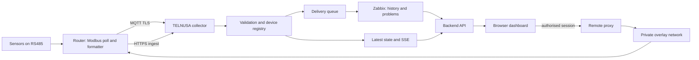

# TELNUSA NMS

A self-hosted monitoring dashboard for remote sensor sites. Field devices expose
telemetry (power, energy, environmental readings) over Modbus; a router forwards it
over MQTT or HTTPS; the platform stores it in Zabbix, serves it through its own API
and renders it in an operations-style web UI, including secure remote access to the
device's own WebUI and SSH console.

The reference deployment targets Teltonika RUT906-class routers with RS485 field
sensors, but the ingestion contract, the dashboard shell and the deployment layout
are deliberately generic: swap the sensor map and the labels and the same codebase
serves another dashboard.

## What it does

- Ingests telemetry from two transports into one validated pipeline: MQTT (TLS) and
  an authenticated HTTP endpoint for devices that cannot hold an MQTT session.
- Validates identity, timestamps, numeric sanity and the approved metric set;
  unknown fields are preserved as unmapped instead of being dropped or invented.
- Registers devices automatically from valid telemetry and keeps a durable
  control-plane state (SQLite) for devices, sessions, queue and audit.
- Queues every reading for Zabbix and drains that queue with bounded retries, so a
  Zabbix outage delays history without stopping ingestion, latest state or SSE.
- Serves history, alarms and aggregates from Zabbix history and problems through a
  small JSON API, and pushes live updates to the browser over Server-Sent Events.
- Renders a NOC-style portal: dashboard, device list and detail, monitoring charts
  with explicit time ranges, alarms, reports with multi-metric charts and XLSX
  export, settings and user management.
- Provides remote access without exposing the device: the browser talks only to the
  portal, which maps an authorised session to a trusted device target on a private
  overlay network. The same policy covers the native WebUI (reverse proxied in an
  iframe) and the SSH console (through Guacamole).

## Architecture



Rules the implementation follows:

- The browser never connects directly to MQTT, the Zabbix API, the database or a
  field device; every call goes through the backend.
- Remote targets are resolved server-side from the device registry. The browser
  never supplies a host or URL, so the proxy cannot be pointed at anything else.
- Real mode never falls back to mock data. Missing readings render as `NO DATA`,
  never as a fabricated value.
- Status vocabulary is explicit: `NOT IMPLEMENTED`, `IMPLEMENTED`, `LOCALLY
  VERIFIED`, `INTEGRATION READY`, `REAL VERIFIED`, `BLOCKED: EXTERNAL DEPENDENCY`.

## Stack

| Layer | Technology |
| --- | --- |
| Frontend | React 19, TypeScript, Vite, Tailwind CSS v4, shadcn/Radix primitives, Chart.js with the date-fns time adapter, React Router |
| Backend | Python standard library only (no web framework), SQLite for control-plane state, background workers for delivery and retention |
| Monitoring core | Zabbix 7.4 (trapper items, history, problems), Grafana provisioning for dashboards |
| Remote access | Apache reverse proxy, Guacamole and guacd, private overlay network (ZeroTier) |
| Devices | Teltonika RUT906: Modbus client, Data Sender with a Lua formatter, MQTT TLS or HTTPS output |

## Repository layout

```
src/                 React application: pages, components, hooks, services, i18n, mock data
backend/             Python API, collector, processors, Zabbix client, store, tests
ops/grafana/         Grafana provisioning: data source and the overview dashboard
deploy/, deployment/ Apache virtual host, systemd unit, tunnel configuration
scripts/             Deployment, packaging and device operations helpers
public/              Self-hosted Inter webfont and static assets
```

## Backend modules

| Module | Responsibility |
| --- | --- |
| `app.py` | HTTP routing, authentication, sessions, CSRF, rate limits, API surface |
| `store.py` | SQLite schema and access: devices, metrics, latest state, queue, sessions, audit |
| `telemetry.py` | Payload contract, validation and normalisation |
| `processor.py` | Ingest pipeline, device registry, alarm evaluation, SSE publication |
| `zabbix_client.py` | Host and item reconciliation, sender submission, history and problem reads |
| `rollup.py` | Time-window resolution, downsampling and gap handling for charts |
| `analytics.py` | Aggregates used by reports and the energy calculations |
| `mqtt_collector.py` | MQTT TLS collector with reconnect and backoff |
| `remote.py`, `tunnel.py` | Trusted device targets and the private overlay path |
| `guacamole.py` | Signed, encrypted terminal grants for the SSH console |
| `xlsx_report.py` | Report workbook builder (values only, unit-aware headers) |
| `alarm_engine.py` | Alarm rules and severity mapping |

## Telemetry contract

Payload identity: the site id, the device serial and the device epoch timestamp.
The approved metric keys are numeric trapper contracts in Zabbix:

```
rut.mppt.pv.v      rut.mppt.pv.a      rut.mppt.out.v     rut.mppt.out.a
rut.pzem.a.voltage rut.pzem.b.voltage rut.pzem.c.voltage
rut.pzem.a.current rut.pzem.b.current rut.pzem.c.current
rut.pzem.energy.kwh
```

Zabbix host identity is deterministic: `RUT-<serial>`. Items belong to one
template; reconciliation never duplicates a host.

## Sensors and scaling

Sensor integration is treated as data, not as code. Each sensor contributes a unit
id, a function code, register offsets and a scaling factor. A sensor whose model,
interface or scaling has not been verified on the bench is marked
`NOT INTEGRATED` and its readings stay `NO DATA` — the platform does not guess a
protocol, an address or a billing-grade scale factor.

## Getting started

Requirements: Node.js 22 or newer for the frontend build, Python 3.11 or newer for
the backend, and a reachable Zabbix instance for real mode.

```bash
npm install
npm run dev            # frontend on http://localhost:5173, Vite dev server
python3 -m backend.app # backend API on http://127.0.0.1:8080
```

The frontend reads `VITE_*` values only; see `.env.example`. Backend configuration
is environment based; see `backend/.env.example` for the variable names (values are
never committed). With `VITE_DATA_MODE=mock` the UI renders deterministic fixture
data and needs no backend; with `real` it talks to the API and never fabricates.

## Testing

```bash
npm test               # frontend unit tests
npm run test:backend   # backend suite
npx tsc --noEmit       # type check
npm run lint           # lint
```

## Deployment

```bash
npm run build          # emits dist/ for Apache
```

The repository ships the pieces the deployment needs: an Apache virtual host that
serves `dist/` and proxies `/api` to the loopback backend, a systemd unit for the
backend service, and Grafana provisioning for the Zabbix data source and the
overview dashboard. Typical layout: application under `/opt/telnusa-nms`, state
under `/var/lib/telnusa-nms`, service environment under `/etc/telnusa-nms`.

Operational principles: the backend binds loopback only; the reverse proxy is the
single ingress; the trusted-proxy hop count is configured explicitly so client
addresses for rate limits and audit come from the real peer; secrets live in the
service environment file with owner-only permissions.

## Reuse as a starting point

To adapt this codebase to another dashboard, replace the telemetry contract in
`backend/telemetry.py` and the Zabbix key set in `backend/zabbix_contract.py`, then
update the sensor map, the page labels in `src/i18n` and the fixture data in
`src/mock`. The ingestion pipeline, delivery queue, rollup, chart components,
report export, remote access and deployment layout stay as they are.

## Status

Field deployment for a small number of sites. The sensor map reflects the
commissioned hardware of those sites; the software itself is transport, storage and
presentation only. MQTT requires broker credentials configured on both sides;
where a broker credential is not available, the HTTP ingest path carries telemetry.
