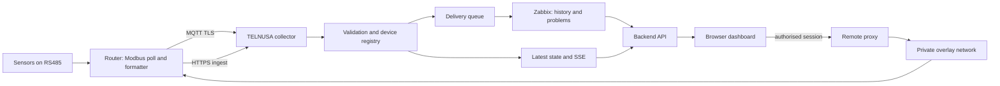

# TELNUSA NMS

A self-hosted monitoring dashboard for remote sensor sites. Field devices expose
telemetry (power, energy, environmental readings) over Modbus; a router forwards it
over MQTT or HTTPS; the platform stores it in Zabbix, serves it through its own API
and renders it in an operations-style web UI, including secure remote access to the
device's own WebUI and SSH console.

The reference deployment targets Teltonika RUT906-class routers with RS485 field
sensors, but the ingestion contract, the dashboard shell and the deployment layout
are deliberately generic: swap the sensor map and the labels and the same codebase
serves another dashboard.

## What it does

- Ingests telemetry from two transports into one validated pipeline: MQTT (TLS) and
  an authenticated HTTP endpoint for devices that cannot hold an MQTT session.
- Validates identity, timestamps, numeric sanity and the approved metric set;
  unknown fields are preserved as unmapped instead of being dropped or invented.
- Registers devices automatically from valid telemetry and keeps a durable
  control-plane state (SQLite) for devices, sessions, queue and audit.
- Queues every reading for Zabbix and drains that queue with bounded retries, so a
  Zabbix outage delays history without stopping ingestion, latest state or SSE.
- Serves history, alarms and aggregates from Zabbix history and problems through a
  small JSON API, and pushes live updates to the browser over Server-Sent Events.
- Renders a NOC-style portal: dashboard, device list and detail, monitoring charts
  with explicit time ranges, alarms, reports with multi-metric charts and XLSX
  export, settings and user management.
- Provides remote access without exposing the device: the browser talks only to the
  portal, which maps an authorised session to a trusted device target on a private
  overlay network. The same policy covers the native WebUI (reverse proxied in an
  iframe) and the SSH console (through Guacamole).

## Screenshots

Captured from the portal running in development data mode, so the numbers are
deterministic fixtures rather than field readings.

### Operations dashboard


Fleet state, instantaneous PV generation, accumulated energy, both sensor groups
and the recent event feed on one screen.

### Telemetry analytics


Per-metric charts with an explicit range, resolution and data-quality header. An
unintegrated or silent source is stated as such instead of being drawn as zero.

### Devices


### Device detail


### Reports and export


Metric selection, period, per-metric charts and the XLSX / CSV / print outputs.

### Alarms


## Architecture



Rules the implementation follows:

- The browser never connects directly to MQTT, the Zabbix API, the database or a
  field device; every call goes through the backend.
- Remote targets are resolved server-side from the device registry. The browser
  never supplies a host or URL, so the proxy cannot be pointed at anything else.
- Real mode never falls back to mock data. Missing readings render as `NO DATA`,
  never as a fabricated value.
- Status vocabulary is explicit: `NOT IMPLEMENTED`, `IMPLEMENTED`, `LOCALLY
  VERIFIED`, `INTEGRATION READY`, `REAL VERIFIED`, `BLOCKED: EXTERNAL DEPENDENCY`.

## Stack

| Layer | Technology |
| --- | --- |
| Frontend | React 19, TypeScript, Vite, Tailwind CSS v4, shadcn/Radix primitives, Chart.js with the date-fns time adapter, React Router |
| Backend | Python standard library only (no web framework), SQLite for control-plane state, background workers for delivery and retention |
| Monitoring core | Zabbix 7.4 (trapper items, history, problems), Grafana provisioning for dashboards |
| Remote access | Apache reverse proxy, Guacamole and guacd, private overlay network (ZeroTier) |
| Devices | Teltonika RUT906: Modbus client, Data Sender with a Lua formatter, MQTT TLS or HTTPS output |

## Repository layout

```
src/                 React application: pages, components, hooks, services, i18n, mock data
backend/             Python API, collector, processors, Zabbix client, store, tests
ops/grafana/         Grafana provisioning: data source and the overview dashboard
deploy/, deployment/ Apache virtual host, systemd unit, tunnel configuration
scripts/             Deployment, packaging and device operations helpers
docs/images/         Screenshots and the installation diagram used in this document
public/              Self-hosted Inter webfont and static assets
```

## Backend modules

| Module | Responsibility |
| --- | --- |
| `app.py` | HTTP routing, authentication, sessions, CSRF, rate limits, API surface |
| `store.py` | SQLite schema and access: devices, metrics, latest state, queue, sessions, audit |
| `telemetry.py` | Payload contract, validation and normalisation |
| `processor.py` | Ingest pipeline, device registry, alarm evaluation, SSE publication |
| `zabbix_client.py` | Host and item reconciliation, sender submission, history and problem reads |
| `rollup.py` | Time-window resolution, downsampling and gap handling for charts |
| `analytics.py` | Aggregates used by reports and the energy calculations |
| `mqtt_collector.py` | MQTT TLS collector with reconnect and backoff |
| `remote.py`, `tunnel.py` | Trusted device targets and the private overlay path |
| `guacamole.py` | Signed, encrypted terminal grants for the SSH console |
| `xlsx_report.py` | Report workbook builder (values only, unit-aware headers) |
| `alarm_engine.py` | Alarm rules and severity mapping |

## Telemetry contract

Payload identity: the site id, the device serial and the device epoch timestamp.
The approved metric keys are numeric trapper contracts in Zabbix:

```
rut.mppt.pv.v      rut.mppt.pv.a      rut.mppt.out.v     rut.mppt.out.a
rut.pzem.a.voltage rut.pzem.b.voltage rut.pzem.c.voltage
rut.pzem.a.current rut.pzem.b.current rut.pzem.c.current
rut.pzem.energy.kwh
```

Zabbix host identity is deterministic: `RUT-<serial>`. Items belong to one
template; reconciliation never duplicates a host.

## Field installation: RUT906 with three sensors


The reference site is one Teltonika RUT906 (RUT9M family) polling two Modbus
devices on a single RS485 bus. The router itself performs the polling and the
formatting, so the platform receives ready values rather than raw registers.


*Device image: Teltonika Networks. The router exposes the Ethernet ports, the
digital inputs and the RS485 terminals used below.*

### Bus and wiring

| Parameter | Value |
| --- | --- |
| Interface | RS485 on `/dev/rs485` (mapped to `/dev/ttyS1`) |
| Serial format | 9600 baud, 8 data bits, no parity, 1 stop bit |
| Flow control | Off; the bus runs half duplex |
| Topology | Two-wire bus, one master (the router), two slaves |
| Signals | A (+), B (−) and a common ground reference |

### Sensor 1 — MPPT solar charge controller (IPANDEE)

| Field | Register | Scaling | Metric key |
| --- | --- | --- | --- |
| `pv_voltage` | 2 | ÷ 10 → V | `rut.mppt.pv.v` |
| `charging_current` | 4 | ÷ 10 → A | `rut.mppt.pv.a` |
| `output_voltage` | 5 | ÷ 10 → V | `rut.mppt.out.v` |
| `load_current` | 7 | ÷ 10 → A | `rut.mppt.out.a` |

Modbus RTU, unit id 2. These four values are the DC side of the installation: what
the array produces, and what the controller passes to the load.

### Sensor 2 — three-phase energy meter (PZEM-6L24)

| Field | Register | Scaling | Metric key |
| --- | --- | --- | --- |
| `a_voltage` | 1 | ÷ 10 → V | `rut.pzem.a.voltage` |
| `b_voltage` | 2 | ÷ 10 → V | `rut.pzem.b.voltage` |
| `c_voltage` | 3 | ÷ 10 → V | `rut.pzem.c.voltage` |
| `a_current` | 4 | ÷ 100 → A | `rut.pzem.a.current` |
| `b_current` | 5 | ÷ 100 → A | `rut.pzem.b.current` |
| `c_current` | 6 | ÷ 100 → A | `rut.pzem.c.current` |
| `kwh` | 59 (two registers) | scale to be validated | `rut.pzem.energy.kwh` |

Modbus RTU, unit id 1, function code 04 (input registers). This is the AC side: the
three phase voltages and load currents, plus the accumulated energy counter.

The energy counter is deliberately not treated as billing grade. The register pair
is stored as read, and the scale factor must be confirmed against a reference meter
before any figure derived from it is trusted.

### Sensor 3 — solar irradiance: NOT INTEGRATED

The irradiance reading is part of the design, but it is **not** wired into the
telemetry map, because two references describe it differently:

- one drawing shows a Modbus RS485 device with a possible slave id 3;
- another document describes an analog output (4–20 mA or 0–10 V).

Model, interface, address and scaling therefore remain unverified. Until they are
confirmed on the bench, the metric stays out of the contract and the UI renders the
field as `NO DATA` with the state `NOT INTEGRATED`. Guessing a protocol, a register
or a scale factor here would produce a number that looks plausible and means
nothing, which is worse than an explicit gap.

### On the router

| Step | Detail |
| --- | --- |
| 1 · Modbus client | Polls both units; the cached values land in the device's Modbus database |
| 2 · Data Sender input | One combined input with eleven requests: the four MPPT fields and the seven PZEM fields |
| 3 · Lua formatter | Emits the payload identity (site id, serial, epoch seconds) with numeric sanity per field |
| 4 · Data Sender output | Publishes every 20 s over MQTT TLS (port 8883) or HTTPS to the ingest endpoint |

Verified on the bench: bus parameters, unit ids, both register maps and the
transport. Not verified: the kWh scale factor, the irradiance sensor, and the
broker-side credentials of the production MQTT leg.

## Sensors and scaling

Sensor integration is treated as data, not as code. Each sensor contributes a unit
id, a function code, register offsets and a scaling factor. A sensor whose model,
interface or scaling has not been verified on the bench is marked
`NOT INTEGRATED` and its readings stay `NO DATA` — the platform does not guess a
protocol, an address or a billing-grade scale factor.

## Getting started

Requirements: Node.js 22 or newer for the frontend build, Python 3.11 or newer for
the backend, and a reachable Zabbix instance for real mode.

```bash
npm install
npm run dev            # frontend on http://localhost:5173, Vite dev server
python3 -m backend.app # backend API on http://127.0.0.1:8080
```

The frontend reads `VITE_*` values only; see `.env.example`. Backend configuration
is environment based; see `backend/.env.example` for the variable names (values are
never committed). With `VITE_DATA_MODE=mock` the UI renders deterministic fixture
data and needs no backend; with `real` it talks to the API and never fabricates.

## Testing

```bash
npm test               # frontend unit tests
npm run test:backend   # backend suite
npx tsc --noEmit       # type check
npm run lint           # lint
```

## Deployment

```bash
npm run build          # emits dist/ for Apache
```

The repository ships the pieces the deployment needs: an Apache virtual host that
serves `dist/` and proxies `/api` to the loopback backend, a systemd unit for the
backend service, and Grafana provisioning for the Zabbix data source and the
overview dashboard. Typical layout: application under `/opt/telnusa-nms`, state
under `/var/lib/telnusa-nms`, service environment under `/etc/telnusa-nms`.

Operational principles: the backend binds loopback only; the reverse proxy is the
single ingress; the trusted-proxy hop count is configured explicitly so client
addresses for rate limits and audit come from the real peer; secrets live in the
service environment file with owner-only permissions.

## Reuse as a starting point

To adapt this codebase to another dashboard, replace the telemetry contract in
`backend/telemetry.py` and the Zabbix key set in `backend/zabbix_contract.py`, then
update the sensor map, the page labels in `src/i18n` and the fixture data in
`src/mock`. The ingestion pipeline, delivery queue, rollup, chart components,
report export, remote access and deployment layout stay as they are.

## Status

Field deployment for a small number of sites. The sensor map reflects the
commissioned hardware of those sites; the software itself is transport, storage and
presentation only. MQTT requires broker credentials configured on both sides;
where a broker credential is not available, the HTTP ingest path carries telemetry.
