# TELNUSA NMS

Self-hosted monitoring for sensor sites. Field devices speak Modbus over RS485, a
router publishes the readings, and this platform validates them, stores history in
Zabbix, serves an API, and renders an operations dashboard with remote access to the
device's own WebUI and console.

## Screenshots

Captured from the portal in development data mode, so every number is a fixture.

### Operations dashboard

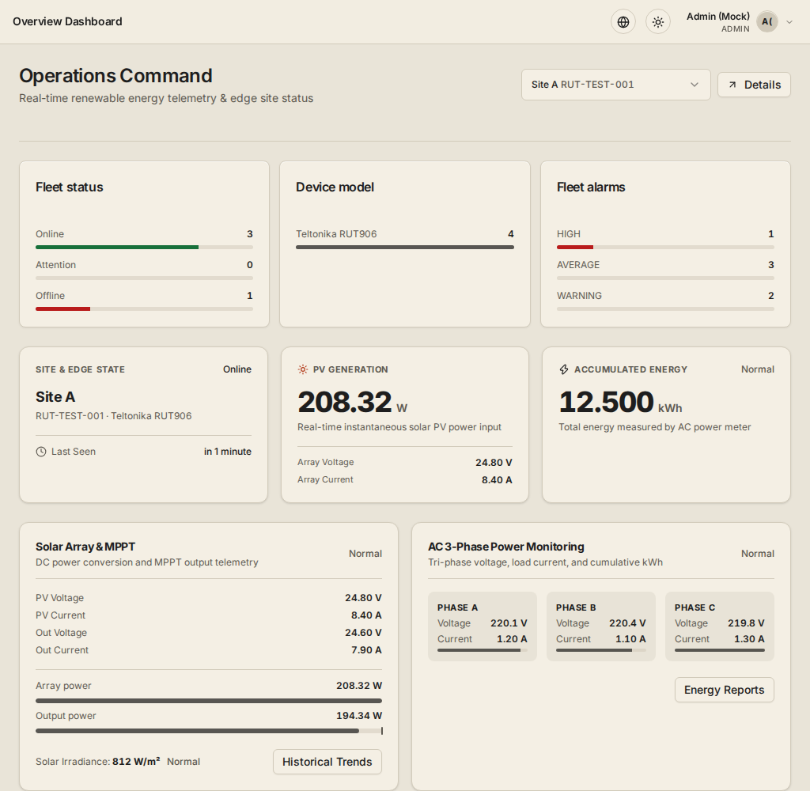

### Telemetry analytics

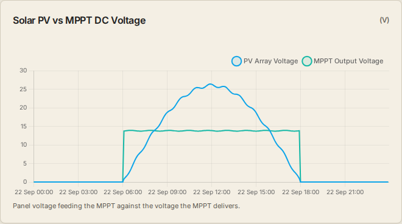

One chart per metric, with range, resolution and data quality stated. A silent or
unintegrated source is labelled instead of drawn as zero.

### Devices

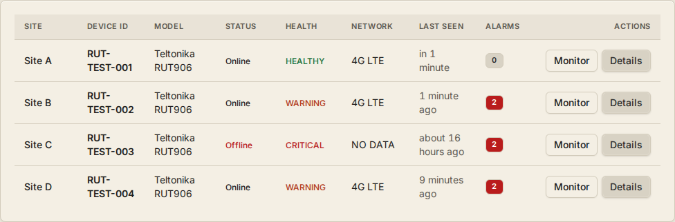

### Device detail

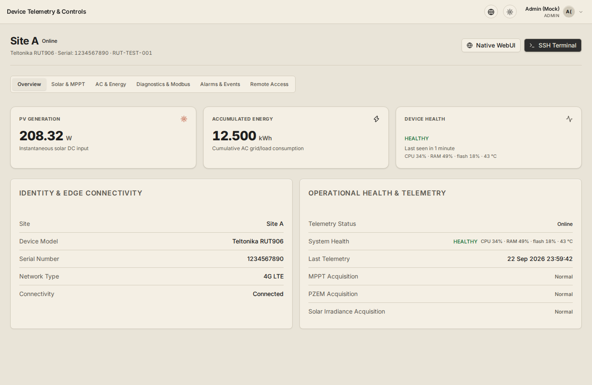

### Reports

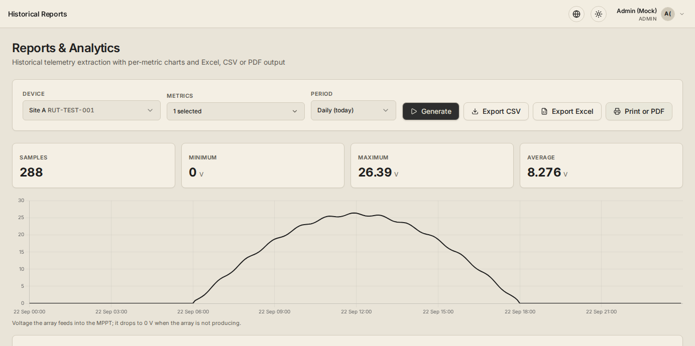

### Alarms

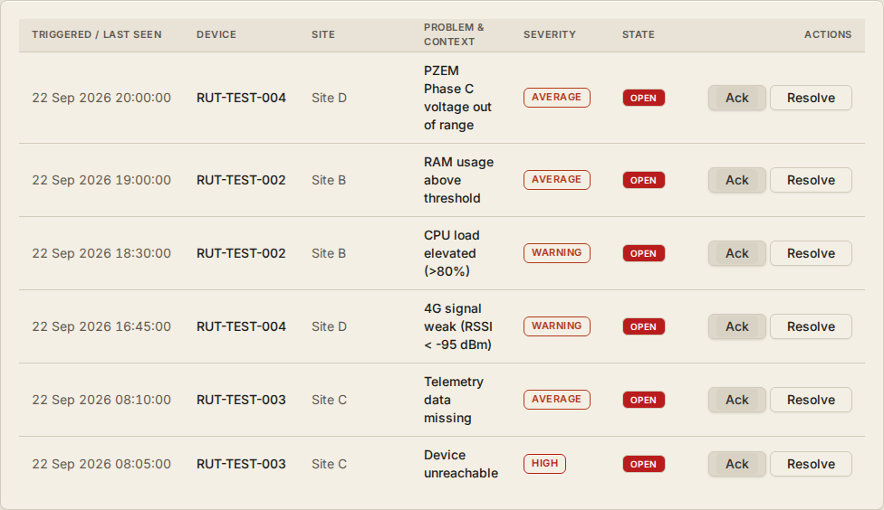

## Stack

| Layer | Component |
| --- | --- |
| Frontend | React 19, TypeScript, Vite, Tailwind CSS v4, Radix primitives, Chart.js with the date-fns adapter, React Router |
| Backend | Python standard library, SQLite for control-plane state, worker threads for delivery and retention |
| Monitoring core | Zabbix 7.4, trapper items, history and problems |
| Dashboards | Grafana 13 with the Zabbix data source, provisioned from `ops/grafana` |
| Remote access | Apache reverse proxy, Guacamole and guacd, ZeroTier overlay |
| Device side | Teltonika RUT906, Modbus client, Data Sender with Lua formatters |

## System architecture

<picture>
  <source media="(prefers-color-scheme: dark)" srcset="docs/images/architecture-dark.svg">
  <source media="(prefers-color-scheme: light)" srcset="docs/images/architecture.svg">
  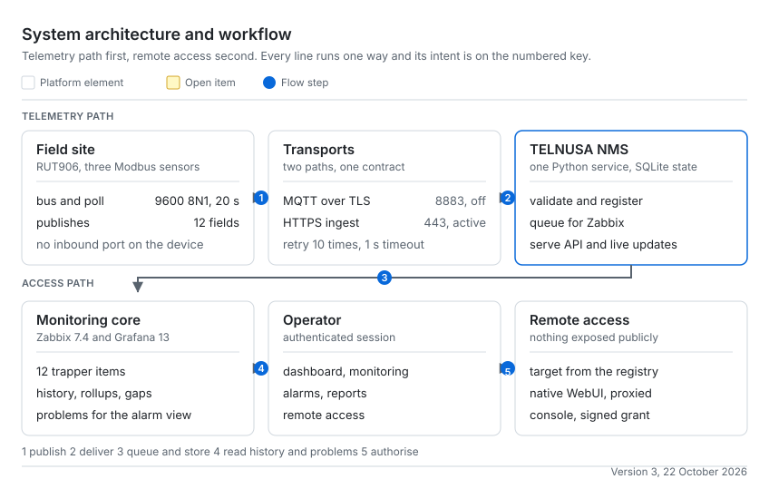
</picture>

Telemetry path on the first row, remote access path on the second. The browser
never reaches MQTT, Zabbix, the database or a device directly, and every remote
target is resolved on the server from the device registry.

## Data path

| Stage | What happens |
| --- | --- |
| 1 Sensors | Two Modbus slaves answer on one RS485 bus, 9600 8N1, polled every 20 s |
| 2 Router | Combines the requested fields into one payload, formats it with Lua, adds site id, serial and epoch seconds |
| 3 Transport | MQTT over TLS on port 8883, or HTTPS push to the ingest endpoint |
| 4 Ingest | Identity, timestamp, numeric sanity and metric whitelist are validated, unknown fields are kept as unmapped |
| 5 State | Device registry, latest state and a durable delivery queue live in SQLite |
| 6 History | Queued readings become Zabbix trapper values, read back as history and problems |
| 7 Presentation | The API serves ranges, rollups and reports, and pushes live updates over SSE |

Rules: the browser never reaches MQTT, Zabbix, the database or a device directly.
Remote targets come from the server-side registry, never from the browser. Real mode
never falls back to mock data, and a missing reading renders as `NO DATA`.

## Repository layout

| Path | Content |
| --- | --- |
| `src/` | React application: pages, components, hooks, services, i18n, fixtures |
| `backend/` | API, ingest pipeline, Zabbix client, store, analytics, tests |
| `ops/grafana/` | Grafana provisioning: data source and overview dashboard |
| `deploy/`, `deployment/` | Apache virtual host, systemd unit, tunnel configuration |
| `scripts/` | Deployment, packaging and device operations helpers |
| `docs/images/` | Screenshots and the installation diagram used in this document |
| `public/` | Self-hosted Inter webfont and static assets |

## Backend modules

| Module | Responsibility |
| --- | --- |
| `app.py` | HTTP routing, sessions, CSRF, rate limits, API surface |
| `store.py` | SQLite schema and access: devices, latest state, queue, sessions, audit |
| `telemetry.py` | Payload contract, validation and normalisation |
| `processor.py` | Ingest pipeline, device registry, alarm evaluation, SSE publication |
| `zabbix_client.py` | Host and item reconciliation, sender submission, history reads |
| `rollup.py` | Window resolution, downsampling and gap handling |
| `analytics.py` | Aggregates for reports and energy calculations |
| `mqtt_collector.py` | MQTT TLS collector with reconnect and backoff |
| `remote.py`, `tunnel.py` | Trusted device targets and the overlay path |
| `guacamole.py` | Signed terminal grants for the SSH console |
| `xlsx_report.py` | Report workbook builder |
| `alarm_engine.py` | Alarm rules, severity mapping and notifications |

## Telemetry contract

Every payload carries the site id, the device serial and the device epoch timestamp.
Twelve numeric metrics are contracted, all of them Zabbix trapper items:

```
rut.mppt.pv.v       rut.mppt.pv.a       rut.mppt.out.v      rut.mppt.out.a
rut.pzem.a.voltage  rut.pzem.b.voltage  rut.pzem.c.voltage
rut.pzem.a.current  rut.pzem.b.current  rut.pzem.c.current
rut.pzem.energy.kwh rut.solar.radiation
```

Zabbix host identity is `RUT-<serial>`, created once and reconciled, never duplicated.

## Field installation: RUT906 and three sensors

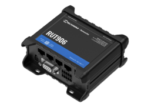

*Device image: Teltonika Networks.*

<picture>
  <source media="(prefers-color-scheme: dark)" srcset="docs/images/installation-rut906-dark.svg">
  <source media="(prefers-color-scheme: light)" srcset="docs/images/installation-rut906.svg">
  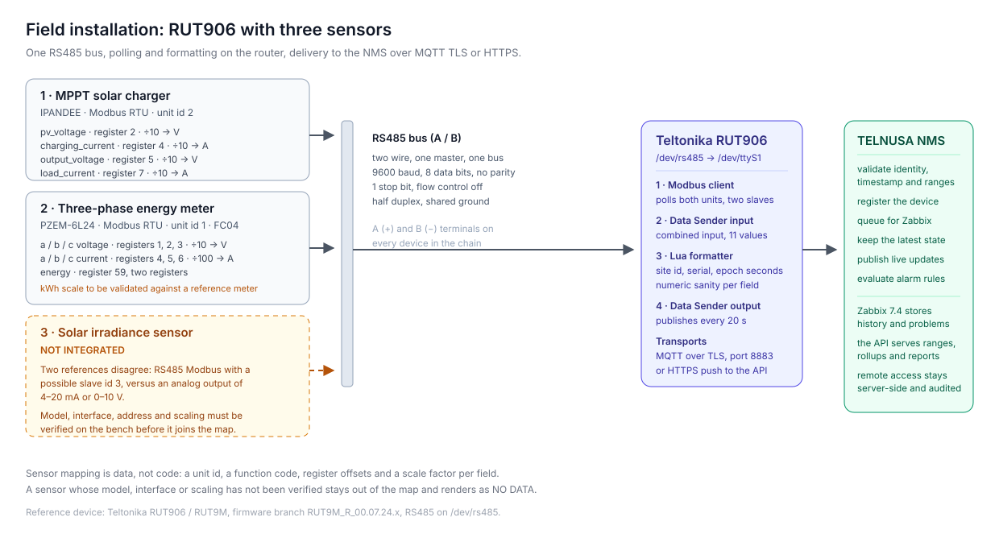
</picture>

### RS485 bus

| Parameter | Value |
| --- | --- |
| Port | `/dev/rs485`, exposed as `/dev/ttyS1` |
| Format | 9600 baud, 8 data bits, no parity, 1 stop bit |
| Flow control | Off, half duplex |
| Topology | One master (router), three Modbus servers |
| Poll period | 20 s per server |

### Modbus servers

| Sensor | Unit id | Function | Registers read | Published fields |
| --- | --- | --- | --- | --- |
| MPPT charge controller (IPANDEE) | 2 | 3 | 12 | 4 |
| Three-phase energy meter (PZEM-6L24) | 1 | 4 | 8 | 7 |
| Pyranometer (Honde RD-PSR-01) | 3 | 3 | 1 | 1 |

### MPPT charge controller

| Field | Register | Function | Scale | Metric |
| --- | --- | --- | --- | --- |
| `pv_voltage` | 2 | 3 | divide by 10, V | `rut.mppt.pv.v` |
| `charging_current` | 4 | 3 | divide by 10, A | `rut.mppt.pv.a` |
| `output_voltage` | 5 | 3 | divide by 10, V | `rut.mppt.out.v` |
| `load_current` | 7 | 3 | divide by 10, A | `rut.mppt.out.a` |

Eight further fields are polled for local diagnostics (charging power, battery
voltage, level and temperature, load power and voltage, internal temperature, system
voltage) and are not part of the contract.

### Three-phase energy meter

| Field | Register | Function | Scale | Metric |
| --- | --- | --- | --- | --- |
| `a_voltage` | 1 | 4 | divide by 10, V | `rut.pzem.a.voltage` |
| `b_voltage` | 2 | 4 | divide by 10, V | `rut.pzem.b.voltage` |
| `c_voltage` | 3 | 4 | divide by 10, V | `rut.pzem.c.voltage` |
| `a_current` | 4 | 4 | divide by 100, A | `rut.pzem.a.current` |
| `b_current` | 5 | 4 | divide by 100, A | `rut.pzem.b.current` |
| `c_current` | 6 | 4 | divide by 100, A | `rut.pzem.c.current` |
| `kwh` | 59 | 4 | 32 bit pair, published as read | `rut.pzem.energy.kwh` |

The energy counter is stored as read, without a derived scale factor. Any figure
built from it must be confirmed against a reference meter first.

### Pyranometer

| Field | Register | Function | Scale | Metric |
| --- | --- | --- | --- | --- |
| `solar_radiation` | 1 | 3 | 1:1, W/m2 | `rut.solar.radiation` |

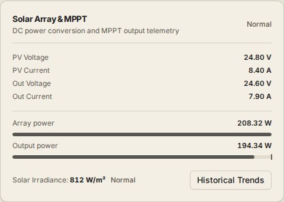

Honde RD-PSR-01 on the same bus as unit 3, holding register 1, one 16 bit register,
high byte first. The formatter publishes it unscaled, so the portal, the history and
the reports read the same number the sensor measures. Alarms on irradiance are left
to the operator: sensible limits depend on the site.

### Router publishing

| Step | Detail |
| --- | --- |
| Combined input | One input collects twelve requests from the three servers |
| Published fields | `pv_voltage`, `charging_current`, `output_voltage`, `load_current`, `a_voltage`, `b_voltage`, `c_voltage`, `a_current`, `b_current`, `c_current`, `kwh`, `solar_radiation` |
| Formatter | Lua per collection, applying the scale factors in the tables above |
| MQTT output | TLS, port 8883, QoS 0, keepalive 60 s, site topic |
| HTTP output | Lua formatter posting the same payload to the ingest endpoint |
| Period | 20 s |

### Verified state

| Item | Status |
| --- | --- |
| Bus parameters, unit ids, register maps, scale factors | Verified against the running router and formatter |
| Pyranometer integration | Integrated and reporting, value read from Zabbix and shown in the portal |
| MQTT leg | Configured on the device, currently disabled there, so telemetry arrives over the HTTPS ingest path |
| Energy scale factor | Published as read, reference-meter validation still open |

## Development

```bash
npm install
npm run dev              # Vite dev server on http://localhost:5173
python3 -m backend.app   # backend API on http://127.0.0.1:8080
```

The frontend reads `VITE_*` values only, see `.env.example`. Backend configuration is
environment based, see `backend/.env.example` for the variable names. With
`VITE_DATA_MODE=mock` the UI renders deterministic fixtures and needs no backend,
with `real` it talks to the API and never fabricates a value.

## Testing

```bash
npm test               # frontend unit tests
npm run test:backend   # backend suite
npx tsc --noEmit       # type check
npm run lint
```

## Deployment

```bash
npm run build          # emits dist/ for the web server
```

| Item | Path |
| --- | --- |
| Application | `/opt/telnusa-nms` |
| State | `/var/lib/telnusa-nms/nms.db` |
| Service environment | `/etc/telnusa-nms/nms.env`, owner only |
| Backend bind | `127.0.0.1:8080`, reached through the reverse proxy |

<picture>
  <source media="(prefers-color-scheme: dark)" srcset="docs/images/deployment-dark.svg">
  <source media="(prefers-color-scheme: light)" srcset="docs/images/deployment.svg">
  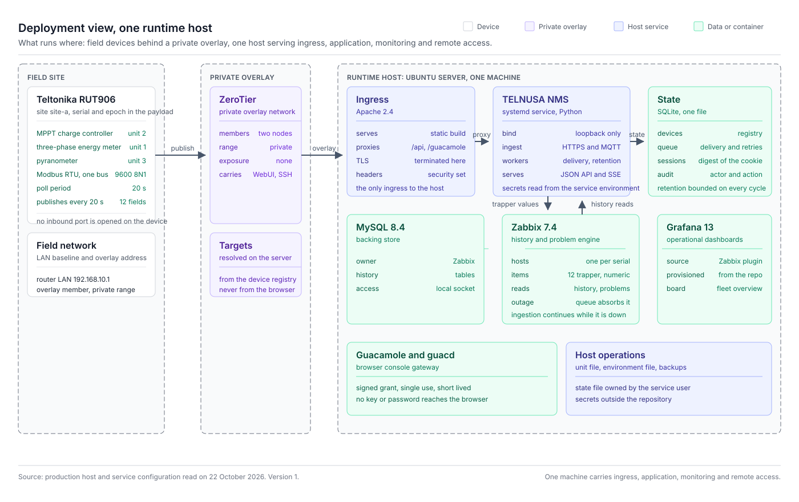
</picture>

The repository ships the virtual host, the systemd unit and the Grafana
provisioning. The proxy is the only ingress, the trusted proxy hop count is set
explicitly so rate limits and audit see the real client, and every secret stays in
the service environment file.

## Reuse

To point this codebase at another site, replace the contract in
`backend/telemetry.py` and the key set in `backend/zabbix_contract.py`, then update
the sensor map, the labels in `src/i18n` and the fixtures in `src/mock`. Ingest,
queue, rollup, charts, exports, remote access and deployment stay unchanged.

## Status

Field deployment for a small number of sites. The sensor map above describes the
commissioned hardware of the reference site.
