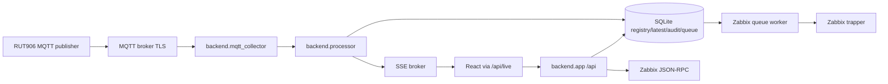

# TELNUSA NMS Backend

Python stdlib HTTP API plus optional MQTT/Zabbix workers. Browser talks only to `/api/*` and `/api/live/*` through Apache.

## Setup

```bash
python3 -m venv backend/.venv
backend/.venv/bin/pip install -r backend/requirements.txt
cp backend/.env.example backend/.env
```

Set real secrets only in the service environment or local untracked `.env`. Do not put MQTT, Zabbix, SMTP/Gmail, SSH, cookie, or database credentials in frontend env files.

## Run

```bash
NMS_DB_PATH=/tmp/telnusa-nms.db backend/.venv/bin/python -m backend.app
```

`MQTT_ENABLED=0` keeps the collector `NOT CONFIGURED`. When enabled, `MQTT_HOST`, `MQTT_CLIENT_ID`, and `MQTT_TOPIC` are required. TLS verification is on by default.

## Integration states

- MQTT: `NOT CONFIGURED`, `CONNECTING`, `CONNECTED`, `SUBSCRIBED`, `DISCONNECTED`, `ERROR`.
- Zabbix API: `NOT CONFIGURED`, `AUTHENTICATED`, `AUTH_FAILED`, `PERMISSION_DENIED`, `TLS_ERROR`, `ERROR`, `INCOMPATIBLE`.
- Zabbix delivery: `CONNECTED` only after sender ack has `processed == total` and `failed == 0`; `DEGRADED` otherwise.
- Devices: `fresh`, `stale`, `offline`, `no_data` from source timestamp, not server optimism.

Telemetry keeps three timestamps:

- `timestamp`: RUT906 source timestamp.
- `receivedAt`: server receive time.
- `processedAt`: backend validation/write time.


## Zabbix 7.4 contract

Target version: Zabbix `7.4.x`. The backend always calls `apiinfo.version` at startup when `ZABBIX_URL` and `ZABBIX_TOKEN` are configured. Unsupported versions are reported as `INCOMPATIBLE`; the worker does not silently assume compatibility from env.

`ZABBIX_URL` may point at the frontend root (`https://host/zabbix`) or the exact JSON-RPC endpoint (`https://host/zabbix/api_jsonrpc.php`). The adapter normalizes it deterministically to one `api_jsonrpc.php` path without duplicate slashes. `ZABBIX_SENDER_HOST`/`ZABBIX_SENDER_PORT` are separate from `ZABBIX_URL`.

Zabbix technical host identity is deterministic: backend `device_id` equals Zabbix technical `host`, e.g. `RUT-1234567890`. Display names are never used as the primary identity.

Required Zabbix config:

- `ZABBIX_URL`
- `ZABBIX_TOKEN`
- `ZABBIX_HOST_GROUP` exact existing host group name
- `ZABBIX_TEMPLATE` exact existing generic RUT906 telemetry template name
- `ZABBIX_SENDER_HOST`
- `ZABBIX_SENDER_PORT`

The backend does not create arbitrary host groups/templates. Missing group/template returns `HOST_GROUP_NOT_FOUND` / `TEMPLATE_NOT_FOUND`. Duplicate exact host lookups return `DUPLICATE_HOST`; no arbitrary host is chosen.

Approved trapper item contract, one source: `backend/zabbix_contract.py`.

| MQTT field | Zabbix key | type | value_type | units |
|---|---|---:|---:|---|
| `sps_mppt_pv_v` | `rut.mppt.pv.v` | 2 | 0 | V |
| `sps_mppt_pv_a` | `rut.mppt.pv.a` | 2 | 0 | A |
| `sps_mppt_out_v` | `rut.mppt.out.v` | 2 | 0 | V |
| `sps_mppt_out_a` | `rut.mppt.out.a` | 2 | 0 | A |
| `a_voltage` | `rut.pzem.a.voltage` | 2 | 0 | V |
| `b_voltage` | `rut.pzem.b.voltage` | 2 | 0 | V |
| `c_voltage` | `rut.pzem.c.voltage` | 2 | 0 | V |
| `a_current` | `rut.pzem.a.current` | 2 | 0 | A |
| `b_current` | `rut.pzem.b.current` | 2 | 0 | A |
| `c_current` | `rut.pzem.c.current` | 2 | 0 | A |
| `kwh` | `rut.pzem.energy.kwh` | 2 | 0 | kWh |

Item type `2` = Zabbix trapper. Value type `0` = float. Missing items return `ITEM_NOT_CONFIGURED` unless `ZABBIX_AUTO_CREATE_ITEMS=1`, in which case only approved item definitions are created.

Real-service harness:

```bash
backend/.venv/bin/python -m backend.integration_test_zabbix
```

Default mode is non-destructive: `ZABBIX_TEST_ALLOW_CREATE=0`. It refuses missing env with `NOT CONFIGURED`; it never deletes production objects. Set `ZABBIX_TEST_ALLOW_CREATE=1` only to create clearly named `RUT-TEST-INTEGRATION` test objects. Set `ZABBIX_TEST_VERIFY_HISTORY=1` to query `history.get` after sender submission.

## Validation

```bash
python3 -m compileall backend
python3 -m backend.test_backend
backend/.venv/bin/python -m backend.test_backend
```

## Real data flow



No frontend direct MQTT, Zabbix, DB, SSH, RUT906, or trapper connection.
